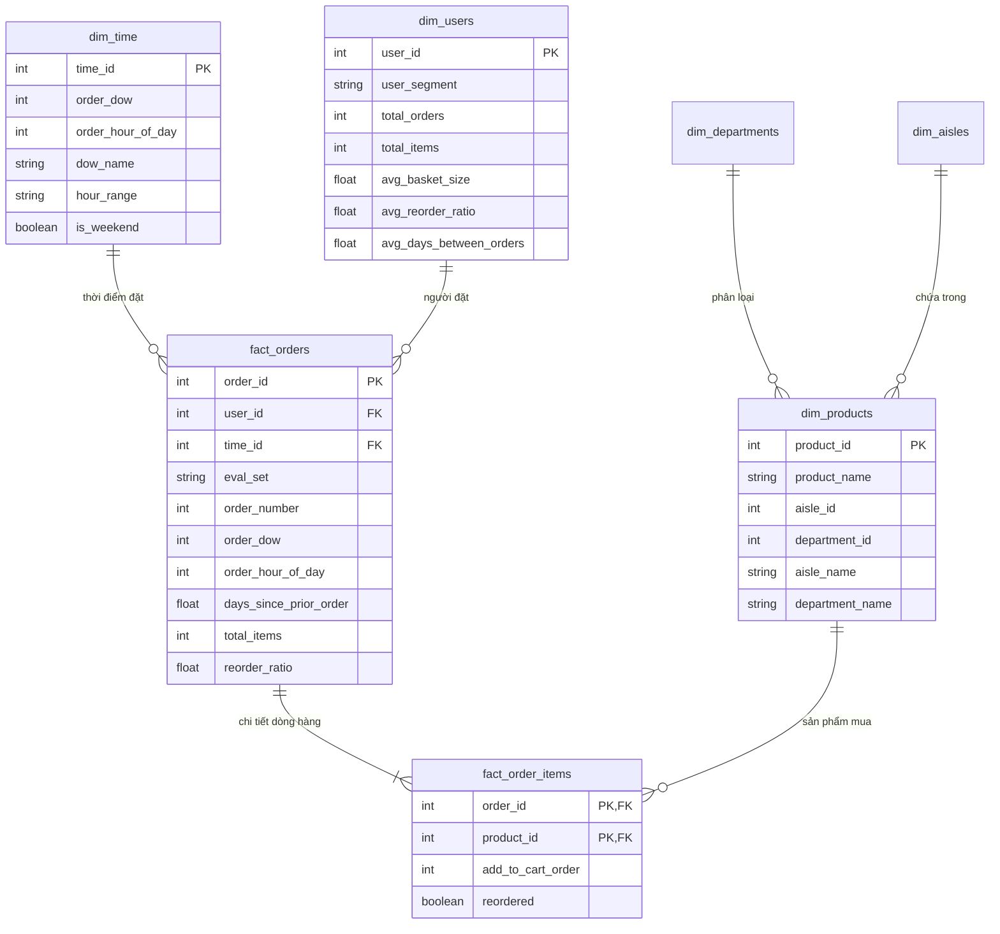

# 🛒 BÁO CÁO ĐỒ ÁN GIỮA KỲ: HỆ THỐNG KHO DỮ LIỆU INSTACART & PHÂN TÍCH OLAP

> **Học phần:** Kho dữ liệu & Kỹ thuật Dữ liệu (Data Warehouse & Data Engineering)  
> **Kiến trúc áp dụng:** Kimball Dimensional Modeling (Mô hình hình sao - Star Schema)  
> **Công nghệ thực thi:** Apache Parquet + DuckDB Embedded OLAP Engine + Streamlit Dashboard  

---

## 📖 1. TỔNG QUAN ĐỀ TÀI & BÀI TOÁN NGHIỆP VỤ

### 1.1. Bối cảnh
**Instacart** là nền tảng giao hàng tạp hóa và siêu thị trực tuyến hàng đầu. Bộ dữ liệu bao gồm hơn **3.4 triệu đơn hàng** với hơn **33.8 triệu dòng chi tiết giỏ hàng** của hơn **206.000 người tiêu dùng** tại Hoa Kỳ.

### 1.2. Mục tiêu của Kho Dữ Liệu
Hệ thống Kho dữ liệu được xây dựng nhằm phục vụ các mục tiêu nghiệp vụ cốt lõi:
1. **Phân tích hành vi đơn hàng:** Đo lường lượng đơn đặt theo từng ngày trong tuần và khung giờ trong ngày để tối ưu nguồn lực nhân sự giao vận.
2. **Quản lý danh mục sản phẩm:** Xác định Top sản phẩm bán chạy nhất và tỷ lệ mua lại (*Reorder Rate*) theo từng ngành hàng.
3. **Phân khúc khách hàng:** Phân loại khách hàng theo tần suất mua hàng (`VIP`, `Frequent`, `Regular`, `New`) để phục vụ các chiến dịch chăm sóc khách hàng mục tiêu.

---

## 🏛️ 2. MÔ HÌNH HÓA DỮ LIỆU (DIMENSIONAL MODELING - STAR SCHEMA)

Hệ thống được thiết kế theo phương pháp luận 4 bước của **Ralph Kimball**:
* **Quy trình nghiệp vụ:** Hoạt động đặt hàng siêu thị trực tuyến (*Grocery Ordering*).
* **Mức hạt (Grain):**
  - `fact_orders`: 1 dòng = 1 đơn hàng được đặt (*Order Grain*).
  - `fact_order_items`: 1 dòng = 1 sản phẩm nằm trong 1 đơn hàng (*Line-item Grain*).

### 2.1. Lược đồ Star Schema (Mermaid Diagram)



---

## ⚡ 3. ĐIỂM SÁNG KỸ THUẬT & TỐI ƯU CÔNG NGHỆ

Dự án áp dụng trực tiếp **khuyến nghị trong Slide bài giảng**:

1. **Lưu trữ dạng cột nén Apache Parquet (thay cho CSV thô):**
   - Bộ dữ liệu CSV thô nặng **680.32 MB** (hơn 33.8 triệu dòng).
   - Được chuyển đổi bằng thư viện **Polars** đa luồng sang **Apache Parquet**.
   - Kết quả: Dung lượng đĩa giảm **77%** xuống còn **156.25 MB** (thời gian chuyển đổi chỉ mất **4.33 giây**).

2. **Cơ sở dữ liệu OLAP dạng cột DuckDB (thay cho MySQL/MariaDB truyền thống):**
   - DuckDB là hệ quản trị CSDL OLAP nhúng nhẹ nhàng, không yêu cầu cài đặt Docker hay cấu hình cổng mạng.
   - Toàn bộ Kho dữ liệu Star Schema hơn 33.8 triệu bản ghi được xây dựng thành công trong **107 giây**.
   - Tốc độ truy vấn các phép toán tổng hợp `GROUP BY`, `ROLLUP` chỉ mất từ **0.3 - 1.5 giây** ngay trên laptop cá nhân.

---

## 🚀 4. HƯỚNG DẪN CÀI ĐẶT & KHỞI CHẠY HỆ THỐNG

### Bước 1: Cài đặt môi trường
Yêu cầu Python 3.10 trở lên. Cài đặt các thư viện phụ thuộc:
```bash
pip install -r requirements.txt
```

### Bước 2: Chạy kiểm thử tự động (Data Quality Tests)
```bash
pytest tests/
```
*(4/4 bài kiểm thử kiểm tra tính toàn vẹn và số lượng bản ghi của Fact & Dimension).*

### Bước 3: Khởi chạy Dashboard Báo cáo (Streamlit)
```bash
python run_dashboard.py
```
Hoặc:
```bash
streamlit run dashboard/app.py
```
Truy cập giao diện tại: `http://localhost:8501`.

---

## 📊 5. DANH MỤC TRUY VẤN OLAP NÂNG CAO (`sql/02_olap_queries.sql`)

Dự án cung cấp sẵn kịch bản 6 câu truy vấn OLAP chuẩn ANSI SQL tại [sql/02_olap_queries.sql](file:///d:/DataWarehouse/DataWarehouse/sql/02_olap_queries.sql) (có thể chạy trực tiếp trên giao diện tại trang **06 - OLAP Studio**):

1. **ROLL-UP:** Tổng hợp doanh số phân cấp `Ngành hàng -> Kệ hàng -> Sản phẩm`.
2. **CUBE:** Phân tích đa chiều ma trận `Ngày trong tuần x Khung giờ`.
3. **WINDOW FUNCTION:** Xếp hạng sản phẩm bán chạy nhất từng ngành (`DENSE_RANK() OVER (...)`).
4. **SLICE & DICE:** So sánh hành vi mua sắm giữa Ngày thường và Cuối tuần.
5. **MARKET SHARE:** Tính tỷ trọng đóng góp của các phân khúc khách hàng (`SUM(...) OVER ()`).
6. **BINNING:** Thống kê phân bố giỏ hàng theo các mức kích cỡ (`CASE WHEN ...`).

---

## 🎯 6. BỘ CÂU HỎI & TRẢ LỜI VẤN ĐÁP GIỮA KỲ (ORAL DEFENSE)

* **Hỏi:** *Tại sao em lại chọn mô hình Star Schema thay vì Snowflake Schema?*
  - **Đáp:** Star Schema chuẩn hóa phẳng bảng `dim_products` (gộp sẵn `department_name` và `aisle_name`), giúp giảm bớt các phép `JOIN` tốn kém khi truy vấn trên tập dữ liệu lớn 33+ triệu dòng, tối ưu tốc độ đọc cho các báo cáo OLAP.

* **Hỏi:** *Làm thế nào em xử lý được tập dữ liệu 33 triệu dòng trên máy cá nhân mà không bị tràn RAM?*
  - **Đáp:** Em đã áp dụng định dạng lưu trữ dạng cột nén **Apache Parquet** và hệ quản trị CSDL dạng cột nhúng **DuckDB** theo đúng khuyến nghị trong slide bài giảng. Nhờ lưu trữ dạng cột, dữ liệu giảm 77% dung lượng và DuckDB chỉ quét đúng các cột cần phân tích thay vì quét toàn bộ dòng.

* **Hỏi:** *Phân khúc khách hàng VIP, Regular trên Dashboard được tính bằng cách nào?*
  - **Đáp:** Được tính toán bằng quy tắc nghiệp vụ SQL `CASE WHEN` tại tầng ETL dựa trên tổng số đơn hàng đã đặt ($\ge 50$ đơn là VIP, $\ge 20$ là Frequent, $\ge 10$ là Regular, còn lại là New).
